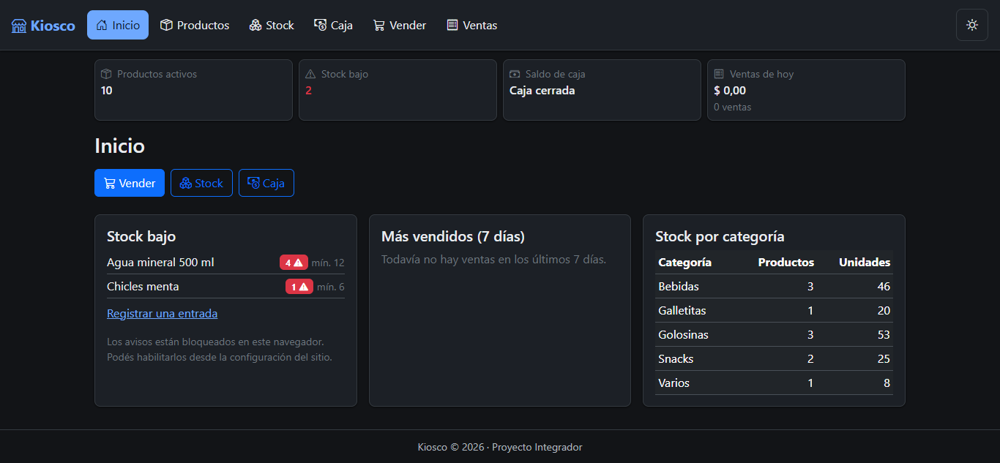
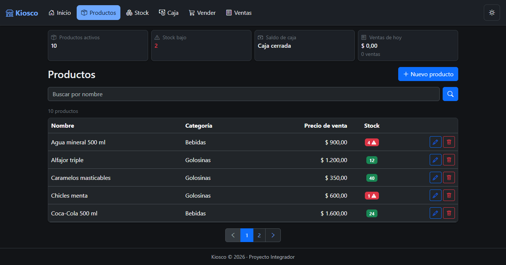
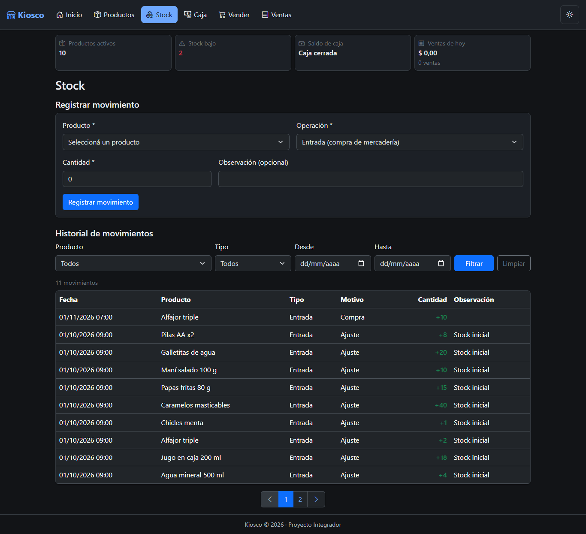
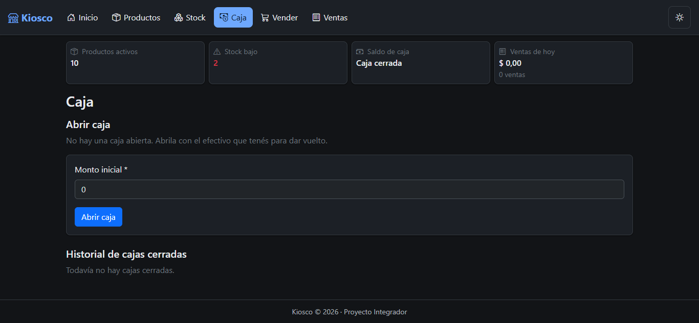
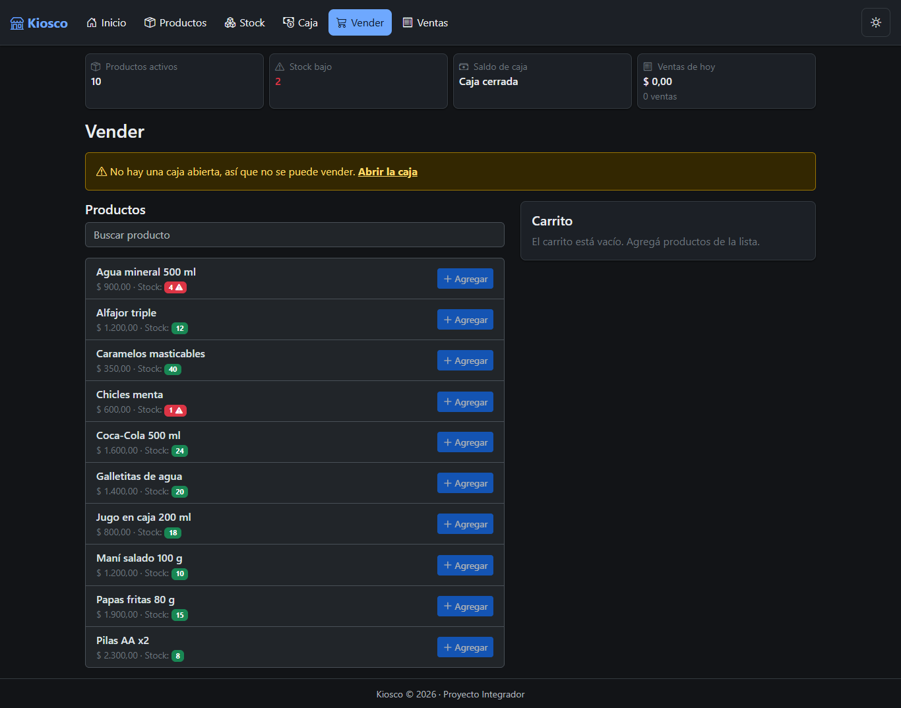
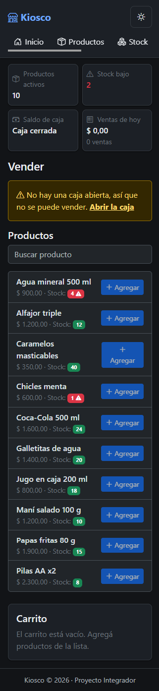
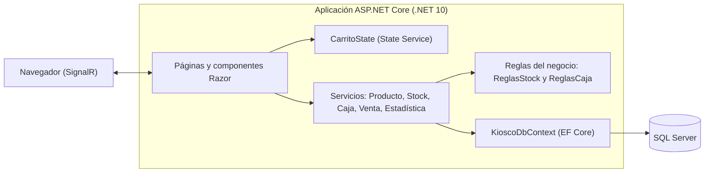
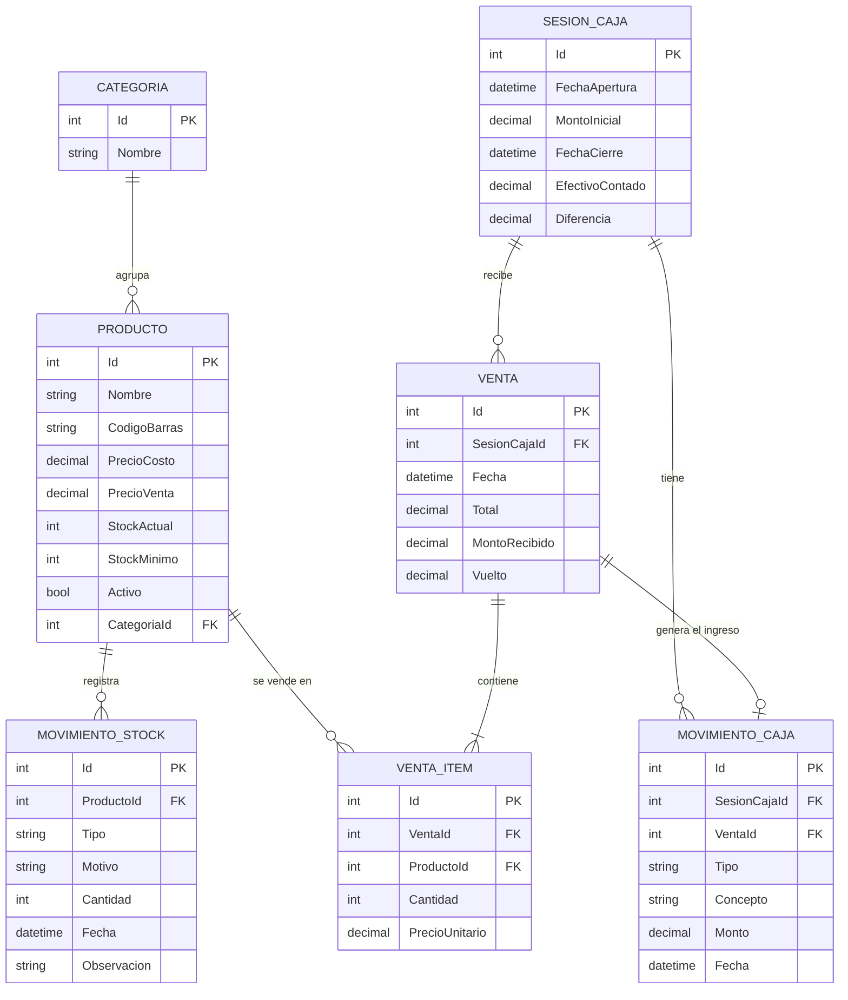
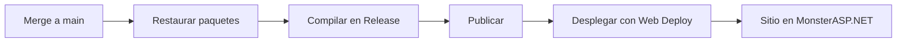

# Kiosco · Gestión de stock y caja en efectivo

[](https://github.com/8kta-hub/kiosco-blazor/actions/workflows/deploy.yml)


Aplicación web para administrar un kiosco: controla el **stock** de la mercadería, el **dinero en efectivo** de la caja y las **ventas**, y deja un historial de todo lo que pasa. Es el Proyecto Integrador de la materia *Desarrollo Web con Blazor* (Espacio de Definición Institucional).

**Demo en línea:** https://kiok.runasp.net · **Estado del servicio:** https://kiok.runasp.net/health

> La demo corre en un hosting gratuito: la primera carga después de un rato sin uso puede tardar unos segundos.

## Capturas

| Inicio | Productos |
|---|---|
|  |  |

| Stock | Caja |
|---|---|
|  |  |

| Venta con carrito | Venta en el celular (375 px) |
|---|---|
|  |  |

## Funcionalidades

- **Productos:** alta, edición y baja con validación avanzada; lista con búsqueda y paginación contra la base de datos.
- **Stock:** entradas, mermas y ajustes con historial paginado y filtrado; alerta visual de stock bajo.
- **Caja en efectivo:** apertura, ingresos y egresos con concepto, saldo en vivo y cierre con arqueo (diferencia entre lo esperado y lo contado); historial de cajas.
- **Ventas:** carrito, monto recibido y vuelto. Al confirmar, la venta, el descuento de stock y el ingreso en caja se guardan en una sola transacción.
- **Estadísticas reales** (consultas con `GroupBy`): resumen en el encabezado y panel de inicio con stock bajo, productos más vendidos y stock por categoría.
- **Modo oscuro** que se recuerda entre sesiones (`localStorage` mediante JS Interop).
- **JS Interop:** foco automático en el buscador, copiar el resumen de cierre de caja, imprimir el arqueo y el comprobante, y avisos del navegador por stock bajo.
- **Accesibilidad y diseño adaptable:** HTML5 semántico, atributos ARIA y uso cómodo desde 375 px.

### Reglas de negocio

- El stock nunca puede quedar negativo.
- Cada cambio de stock deja un movimiento, guardado en la misma transacción que el cambio.
- El dinero usa `decimal` con precisión (18,2): nunca `double`.
- Solo puede haber una caja abierta (también lo garantiza un índice único en la base).
- No se vende ni se mueve dinero sin caja abierta.
- Un egreso no puede superar el saldo de la caja.
- Saldo esperado = monto inicial + ingresos − egresos.
- Un producto con historial de stock no se elimina: se desactiva.
- El precio de una venta lo toma el servidor de la base de datos, nunca la pantalla.

## Tecnologías

| Área | Tecnología |
|---|---|
| Plataforma | .NET 10, ASP.NET Core, Blazor Server (interactividad en el servidor) |
| Interfaz | Componentes Razor, HTML5 semántico, CSS Isolation, variables CSS, Bootstrap 5 y Bootstrap Icons |
| Estado | State Service (`CarritoState`) registrado como `Scoped`, con `event Action? OnChange` |
| JavaScript | Módulo ES6 cargado con `IJSRuntime` e `IJSObjectReference`, sin scripts globales |
| Datos | Entity Framework Core 10 (Code-First) con SQL Server, `IDbContextFactory`, migraciones y *seed* |
| Configuración | `appsettings` por ambiente, User Secrets, `ILogger<T>` y Health Checks |
| Calidad y entrega | Git Flow, Conventional Commits, GitHub Actions (CI/CD) |
| Hosting | MonsterASP.NET (publicación por Web Deploy) |

## Arquitectura



Las páginas no conocen la base de datos: piden todo a los **servicios**, que usan una fábrica de contextos de EF Core (`IDbContextFactory`) para obtener un contexto nuevo por operación. Las **reglas del negocio** (stock y dinero) viven en un solo lugar y las reutilizan todos los servicios, por ejemplo la venta.

## Modelo de datos



Los tipos (`Tipo`, `Motivo`) son *enums* guardados como texto. Las fechas se guardan en UTC y se muestran en hora de Argentina.

## Estructura del repositorio

```text
kiosco-blazor/
├── .github/workflows/deploy.yml     # CI/CD con GitHub Actions
├── docs/
│   ├── capturas/                    # Capturas de pantalla del README
│   └── historias-de-usuario.md      # Historias, criterios de aceptación y Definition of Done
├── Kiosco/
│   ├── Components/
│   │   ├── Compartidos/             # Componentes reutilizables
│   │   ├── Layout/                  # Layout semántico, menú y resumen del encabezado
│   │   └── Pages/                   # Páginas
│   ├── Data/                        # KioscoDbContext
│   ├── Migrations/                  # Migraciones de EF Core
│   ├── Models/                      # Entidades y modelos de formulario
│   ├── Services/                    # Servicios y reglas del negocio
│   ├── wwwroot/                     # Estilos globales y módulo JavaScript
│   └── Program.cs
├── CHANGELOG.md
└── README.md
```

## Cómo ejecutarlo en tu máquina

**Requisitos:** [.NET 10 SDK](https://dotnet.microsoft.com/download), SQL Server Express (o LocalDB) y Git.

```powershell
git clone https://github.com/8kta-hub/kiosco-blazor.git
cd kiosco-blazor/Kiosco

dotnet user-secrets set "ConnectionStrings:Default" "Server=localhost\SQLEXPRESS;Database=KioscoDb;Trusted_Connection=True;TrustServerCertificate=True"

dotnet run
```

Abrí la dirección que muestra la consola (por ejemplo, `https://localhost:7267`). Al iniciar, la aplicación **crea la base de datos y aplica las migraciones** sola, y carga 5 categorías y 10 productos de ejemplo. Ajustá `Server=` si tu instancia de SQL Server tiene otro nombre.

## Configuración

| Clave | Dónde se define | Para qué sirve |
|---|---|---|
| `ConnectionStrings:Default` | User Secrets (desarrollo) · variable de entorno `ConnectionStrings__Default` (producción) | Conexión a SQL Server |
| `ASPNETCORE_ENVIRONMENT` | `launchSettings.json` (desarrollo) · variable de entorno en el hosting | Elige `appsettings.Development.json` o `appsettings.Production.json` |
| `Logging:LogLevel` | `appsettings.*.json` | Nivel de detalle de los registros |

**El repositorio no contiene credenciales.** La cadena de conexión de desarrollo vive en los User Secrets de tu usuario de Windows, y la de producción, en una variable de entorno del hosting.

## Migraciones

Las migraciones se aplican solas al iniciar la aplicación (`Database.MigrateAsync()`). Para crear una nueva después de cambiar el modelo:

```powershell
# Consola del Administrador de paquetes de Visual Studio
Add-Migration NombreDeLaMigracion

# o con la CLI, desde la carpeta Kiosco
dotnet ef migrations add NombreDeLaMigracion
```

## Integración y despliegue continuos

Cada Pull Request hacia `develop` o `main` compila el proyecto. Cada merge a `main` además publica la aplicación en el hosting.



El workflow está en [`.github/workflows/deploy.yml`](.github/workflows/deploy.yml). Los datos de acceso al hosting viven como *secrets* del repositorio (`WEBSITE_NAME`, `SERVER_COMPUTER_NAME`, `SERVER_USERNAME` y `SERVER_PASSWORD`), nunca en el código.

## Flujo de trabajo

- **Git Flow:** `main` (lo que está publicado), `develop` (integración) y `feature/*` (una por módulo).
- **Conventional Commits:** `feat(stock): agregar reglas de stock`, `fix: ...`, `docs: ...`, `refactor: ...`, `chore: ...`.
- **Pull Requests** de `feature/*` a `develop`, con una revisión propia comentada antes del merge.
- **Gestión:** tablero Kanban y *issues* en GitHub Projects; las [historias de usuario](docs/historias-de-usuario.md) tienen criterios de aceptación y una Definition of Done.

## Documentación relacionada

- [CHANGELOG](CHANGELOG.md): historial de versiones.
- [Historias de usuario](docs/historias-de-usuario.md).
- Los servicios tienen comentarios XML (`<summary>`, `<param>`, `<returns>`, `<exception>`) que muestra IntelliSense.